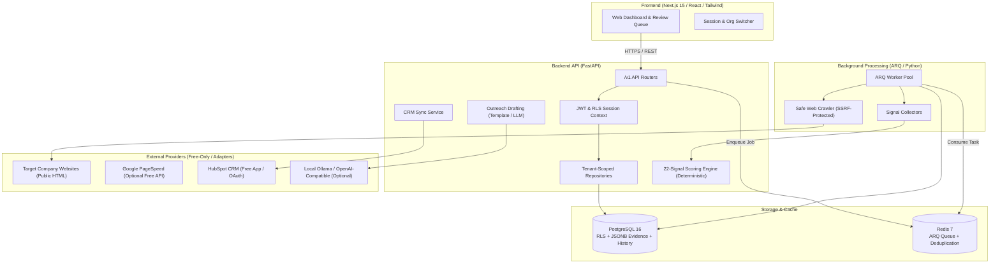
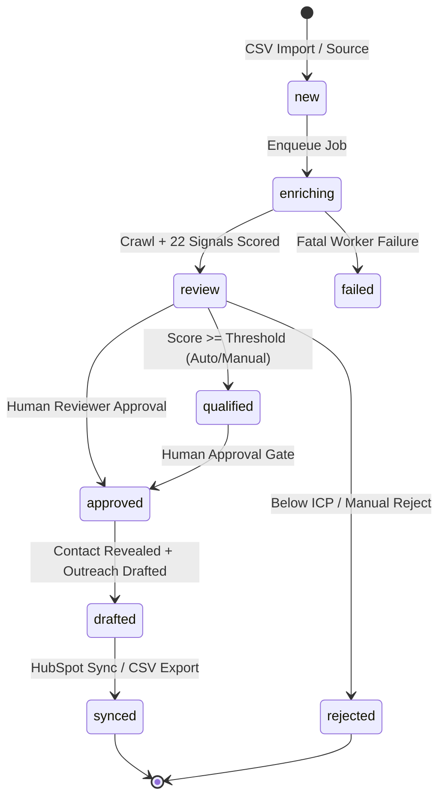

# LeadFlow System Architecture

## 1. System Overview

LeadFlow is a multi-tenant B2B lead qualification and CRM synchronization platform architected as a **Modular Monolith** with separated background workers.

---

## 2. Component Design

### 2.1 Backend (`backend/`)
- **FastAPI:** High-performance async web framework.
- **SQLAlchemy 2.x (Async):** Relational ORM handling data access, connection pooling, and tenant session variables.
- **Pydantic v2:** Request/response schemas, rigorous boundary validation.
- **Alembic:** Version-controlled database migrations.
- **ARQ:** Async Redis-backed job queue for distributed enrichment and crawling tasks.
- **Crawler Subsystem:** Built with `httpx` and `BeautifulSoup4`. Features custom DNS pre-resolution resolving hostnames before connection, rejecting all private, loopback, multicast, and link-local IP addresses (defense against SSRF).

### 2.2 Frontend (`frontend/`)
- **Next.js 15 (App Router):** Server-side rendered pages with client components for interactive queues.
- **Tailwind CSS & Component Primitives:** Clean, accessible SaaS dashboard with responsive design.
- **Strict Tenant Context:** Organization switching and role validation handled securely via HTTP-only session cookies.

### 2.3 Database & Queue
- **PostgreSQL 16:** The sole authoritative store for all tenant business data, scoring snapshots, lead states, and run checkpoints.
  - Row-Level Security (RLS) policies enforce tenant isolation on every table with `org_id`.
  - JSONB columns store raw signal evidence with full provenance (source URL, timestamps, confidence).
- **Redis 7:** Broker for ARQ background tasks, rate-limit counters, and ephemeral caching.

---

## 3. Data Flow & Lead Pipeline

### Key Security Gates:
1. **SSRF Guard:** No outbound crawler request touches private IP ranges or metadata servers (`169.254.169.254`).
2. **Contact Reveal Gate:** Contact email/phone details remain masked until a human user with appropriate permissions explicitly approves the lead.
3. **Outreach Gate:** Outreach drafts are generated for human review. No automated email sending occurs.
4. **CRM Sync Gate:** Leads are synchronized to HubSpot only after human approval of both the lead and the outreach draft.
