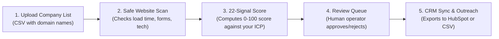

# LeadFlow Architecture: Plain-Language Practical Guide

This guide explains how LeadFlow works in practical terms for business stakeholders and operators, without unnecessary software-engineering jargon.

---

## 1. What LeadFlow Does

LeadFlow is an intelligent platform designed for B2B sales and growth teams. Instead of manually visiting hundreds of prospective customer websites to see if they are a good fit for modern marketing or technology services, LeadFlow:
1. **Takes a list of companies** (via CSV import or domain entry).
2. **Scans their public websites safely** to check technical health, marketing activity, conversion forms, and design modernness.
3. **Calculates a clear qualification score (0–100)** using 22 specific business indicators.
4. **Shows an explainable breakdown** so you understand exactly why a company was marked *Qualified*, *Needs Review*, or *Disqualified*.
5. **Prepares personalized outreach drafts** and syncs approved leads to your CRM (like HubSpot).

---

## 2. How the System Operates End-to-End

### Step 1: Uploading Companies (Lead Ingestion)
When you upload a spreadsheet of prospective clients, LeadFlow cleans the data:
- It removes leading symbols like `=` or `+` that could cause spreadsheet security issues.
- It cleans domain names (e.g., converting `https://www.acme.com/about` to `acme.com`).
- It checks for duplicates so you never accidentally pay to research or contact the same company twice.

### Step 2: Safe Website Scanning
LeadFlow visits the company's public homepage just like a normal web browser.
- **Safety First**: It never attempts to log into private areas or access confidential systems. It enforces strict internet safety rules (called SSRF guards) to prevent contacting private internal networks.
- **What It Measures**: It records how fast the website loads, whether it has a valid security certificate (HTTPS), what content management system it uses (like WordPress or Next.js), and whether it has contact forms or chat buttons.

### Step 3: Rule-Based Qualification Scoring (22 Signals)
Rather than asking a black-box AI to guess if a lead is good, LeadFlow uses **deterministic rules**:
- **Website Group (10 Signals)**: Measures website speed, mobile usability, security, content depth, analytics, and accessibility.
- **Marketing Group (12 Signals)**: Measures search engine metadata (SEO), structured data, blog freshness, customer case studies, video presence, social links, newsletter signup, and active hiring.
- **Your Ideal Customer Profile (ICP)**: You can set the qualification threshold (e.g., 65/100). Companies that score above your threshold are marked *Qualified*; companies that fall below are flagged for manual review or disqualified.
- **No Penalties for Missing Information**: If a company does not have a blog, we score them fairly based on what is observable rather than arbitrarily guessing.

### Step 4: Human Review & Contact Privacy
Before any outreach message is sent or any contact detail is revealed, a human operator reviews the lead in the LeadFlow dashboard. This guarantees quality control and protects contact privacy.

### Step 5: CRM Sync & Outreach
Once a lead is approved, LeadFlow generates a personalized email draft highlighting the specific areas where the company can improve (for example: *"We noticed your site takes 3.8s to load and lacks mobile viewport optimization..."*). Approved leads can then be synced directly to HubSpot or exported as clean CSV files.

---

## 3. Why the Platform Was Built This Way

### 1. 100% Free & Self-Hosted Baseline
LeadFlow is designed so that a business owner or developer can run it without paying for expensive monthly API subscriptions or third-party monitoring services.
- The core website scanner runs entirely on your own server.
- The database (PostgreSQL 16) and background queue (Redis 7) run locally using standard container tools.

### 2. Multi-Tenant Organization Isolation
Multiple companies or sales teams can share the same LeadFlow system without ever seeing each other's data:
- Every lead, scoring rule, and setting belongs strictly to one organization.
- Even if an operator accidentally types an incorrect search, the underlying database strictly blocks access to any other company's records.

### 3. Proactive Quota Guard
Whenever an external service (like Google PageSpeed) is connected, LeadFlow sets a local daily budget:
- If you approach the free limit, LeadFlow warns you in advance.
- If the limit is reached, it automatically pauses and switches to local website scanning.
- **It will never secretly charge your credit card or upgrade your plan.**

### 4. Background Job Processing
Scraping websites and scoring leads takes a few seconds per company. LeadFlow processes these tasks in the background so your dashboard stays fast and responsive. You can upload a list of 200 companies and monitor progress live on screen without waiting for each page to load.
