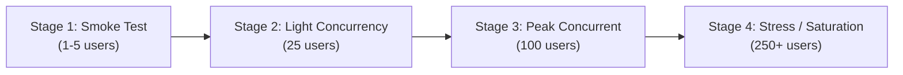

# Progressive Load Testing Plan (Target: 1,000–1,500 Registered Orgs)

In strict adherence to **Mandatory Rule A (Free services and open-source software only)** and **Rule D (Never fabricate success)**, all load tests must execute exclusively against local mock providers and synthetic datasets. **Live third-party APIs (Google PageSpeed, Hunter, HubSpot) must NEVER be subjected to automated load-testing bursts.**

---

## 1. Load Testing Objectives

1. Validate API responsiveness (p95 latency $< 150\text{ ms}$) across concurrent authenticated requests.
2. Verify that PostgreSQL connection pool utilization remains within safe bounds under peak traffic.
3. Validate ARQ queue backpressure and memory stability during large batch submissions (100–500 leads).
4. Prove that tenant Row-Level Security (RLS) policies prevent data leakage even during high concurrent thread interleaving.
5. Verify graceful recovery after simulated worker or API process restarts.

---

## 2. Test Execution Environment & Tools

- **Target System**: Local FastAPI backend running on `http://127.0.0.1:8000`.
- **Infrastructure**: Local PostgreSQL 16 (`127.0.0.1:5432`) and Redis 7 (`127.0.0.1:6379`) running via Docker Compose.
- **Provider Mode**: Strictly set `PROVIDER_ENRICHMENT_MODE=mock` and `PROVIDER_PAGESPEED_MODE=mock`.
- **Tooling**: Locust or Python `httpx.AsyncClient` concurrent benchmarking scripts located in `scratch/`.

---

## 3. Progressive Test Stages

### Stage 1: Smoke & Baseline Verification (1–5 Virtual Users)
- **Workload**: Verify health endpoints (`/v1/health`), scoring catalog (`/v1/scoring/signals`), and single-lead scoring.
- **Success Criteria**: 0% error rate; p95 latency $< 25\text{ ms}$; zero database pool wait time.

### Stage 2: Realistic Interactive SaaS Concurrency (25 Virtual Users)
- **Workload**: 25 concurrent users performing authentication, paginated lead retrieval (`GET /v1/leads`), searching, and filtering.
- **Success Criteria**: 0% error rate; p95 latency $< 75\text{ ms}$; database connections checked out $\le 15$.

### Stage 3: Peak Concurrent Activity (100 Virtual Users)
- **Workload**: 100 concurrent users with 70% read traffic (dashboards, scores) and 30% write traffic (CSV uploads, lead scoring).
- **Success Criteria**: Error rate $< 0.1\%$; p95 latency $< 150\text{ ms}$; p99 latency $< 350\text{ ms}$; PostgreSQL connection pool utilization $\le 80\%$.

### Stage 4: High-Volume Batch Queue Submission (500-Lead Batch Run)
- **Workload**: Enqueue a batch qualification run of 500 leads via ARQ and Redis.
- **Success Criteria**:
  - Worker processes items with cooperative pacing without dropping tasks.
  - Checkpoint updates persist cleanly to PostgreSQL.
  - API remains responsive (p95 $< 100\text{ ms}$) while background worker is actively running.
  - Zero memory leaks in worker process.

### Stage 5: Failure Injection & Recovery
- **Workload**: Terminate background worker process mid-batch run. Restart worker process.
- **Success Criteria**: Worker detects unfinished run from PostgreSQL checkpoint and successfully resumes remaining leads without re-crawling already completed items.

---

## 4. Key Metrics to Record

| Metric | Target Boundary | Unacceptable Boundary |
|---|---|---|
| **API Latency (p50)** | $< 35\text{ ms}$ | $> 100\text{ ms}$ |
| **API Latency (p95)** | $< 150\text{ ms}$ | $> 500\text{ ms}$ |
| **API Latency (p99)** | $< 350\text{ ms}$ | $> 1,000\text{ ms}$ |
| **HTTP Error Rate** | $0.0\%$ | $> 0.5\%$ |
| **DB Pool Wait Time** | $0\text{ ms}$ | $> 500\text{ ms}$ (indicates pool exhaustion) |
| **Worker Queue Lag** | $< 2.0\text{ s}$ per task | $> 15.0\text{ s}$ |
| **Memory Growth (Backend)** | Flat ($\le 250\text{ MB}$) | Monotonic unbounded growth |

---

## 5. Prerequisite Authorization

In adherence to Rule C and Section 11.4:
- Controlled local load tests using synthetic fixtures will be prepared in `scratch/`.
- No load test script will be executed until the operator explicitly reviews and approves the target concurrency level.
