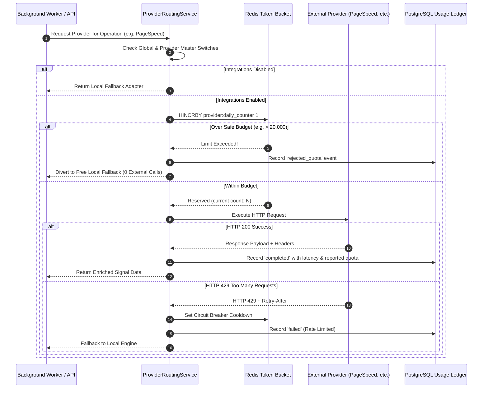

# Central Quota Management, Proactive Warning & Provider Failover

In strict adherence to **Mandatory Rule A (Free services and open-source software only)**, LeadFlow implements a proactive, multi-tiered quota management and routing architecture. The platform never waits for external APIs to reject requests with `HTTP 429 Too Many Requests` or unexpected billing notices; it tracks usage locally, warns administrators ahead of time, and intelligently diverts to free fallbacks before limits are breached.

---

## 1. Core Architecture Principles

1. **Zero-Paid Guarantee**: Under no circumstances will a depleted free quota trigger fallback to a paid tier, billable model, or upgrade prompt. Depletion causes immediate transition to local or free fallbacks.
2. **Two-Tier Synchronization**:
   - **Fast Tier (Redis)**: Sub-millisecond atomic counter reservations using Redis `HINCRBY` to prevent race conditions during concurrent batch runs.
   - **Authoritative Tier (PostgreSQL)**: Durable `provider_usage_ledger` records auditing every attempt, latency, HTTP status, and actual reported quota cost.
3. **Conservative Safe Budgets**: Daily and monthly caps are set slightly below vendor maximums (e.g., 20,000 for PageSpeed's 25,000 daily limit; 20 for Hunter's 25 monthly limit) to provide an infallible safety buffer.
4. **Timezone-Aware Resets**: Quota reset schedules track documented vendor timezones rather than assuming midnight local time.

---

## 2. Configured Provider Quota Boundaries

| Provider | Documented Free Quota | Conservative Safe Budget | Reset Frequency & Timezone | Warning Thresholds | Fallback on Exhaustion |
|---|---|---|---|---|---|
| **Local Safe Crawler** | Unlimited | Unlimited | Continuous (Local) | N/A | Local heuristics |
| **Google PageSpeed Insights** | 25,000 requests / day | **20,000 requests / day** | Daily at Midnight US/Pacific (07:00 UTC) | 50% (10k), 75% (15k), 90% (18k) | Local HTTP asset timing heuristics |
| **Hunter.io** | 25 searches / month | **20 searches / month** (~1 search / day) | Monthly on account billing anchor date (UTC) | 50% (10), 75% (15), 90% (18) | Offline masked contact card |
| **HubSpot Developer Portal** | 100 requests / 10 seconds | **80 requests / 10 seconds** | Sliding 10-second window | 75% (60 req), 90% (72 req) | CSV export baseline |
| **OpenRouter (:free models)** | 20 req/min, 200 req/day | **15 req/min, 160 req/day** | Daily at Midnight UTC | 50% (80), 75% (120), 90% (144) | Deterministic rule-based template engine |

---

## 3. Database Schema: Durable Usage Ledger

The durable usage ledger is modeled in PostgreSQL to track all integration operations:

```sql
CREATE TABLE provider_usage_ledger (
    id UUID PRIMARY KEY DEFAULT gen_random_uuid(),
    org_id UUID NOT NULL REFERENCES organizations(id) ON DELETE CASCADE,
    provider_key VARCHAR(64) NOT NULL,
    operation VARCHAR(64) NOT NULL,
    status VARCHAR(32) NOT NULL, -- 'reserved', 'completed', 'failed', 'rejected_quota'
    credits_used NUMERIC(10, 2) DEFAULT 1.0,
    is_provider_reported BOOLEAN DEFAULT FALSE,
    http_status_code INTEGER,
    latency_ms DOUBLE PRECISION,
    idempotency_key VARCHAR(128) UNIQUE,
    error_message TEXT,
    created_at TIMESTAMPTZ DEFAULT NOW()
);

CREATE INDEX idx_usage_provider_org_period 
ON provider_usage_ledger (provider_key, org_id, created_at);
```

---

## 4. Multi-Tiered Quota Workflow



---

## 5. Proactive Warning Levels & Operator Alerts

| Usage Level | Action Triggered | Operator / Developer Notice |
|---|---|---|
| **< 50% Consumed** | Normal operation | Operational status displays green badge. |
| **50% Consumed** | Informational alert | Dashboard notification: *"Google PageSpeed Insights has consumed 50% (10,000 calls) of its daily safe budget."* |
| **75% Consumed** | Warning alert | Dashboard badge turns yellow; warning logged to application audit trail. |
| **90% Consumed** | Critical warning + Queue Pacing | Queue worker introduces a 2,000ms delay between consecutive provider calls to prevent sudden spikes. |
| **100% Safe Budget** | Immediate Proactive Pause | Provider transitions to `paused_quota_exhausted`. All subsequent requests immediately route to free local fallbacks without contacting external servers. |

---

## 6. HTTP 429 and Cooldown Handling

If an external provider returns an HTTP 429 error despite local safeguards:
1. **Header Inspection**: The response is inspected for `Retry-After`. If present, the cooldown period is set to $\min(\text{Retry-After}, 3600\text{ seconds})$. If absent, a default cooldown of 300 seconds is applied.
2. **Circuit Breaker Trip**: A key `provider:cooldown:{provider_key}` is stored in Redis with the cooldown TTL.
3. **Automatic Routing Bypass**: During the cooldown, `ProviderRoutingService` skips the provider and routes directly to the local fallback without sending probing network requests.
4. **Graceful Job State**: The lead record is not failed; its signal record is marked `available: false` with error code `RATE_LIMITED_COOLDOWN`, allowing lead qualification to proceed using available signals.
